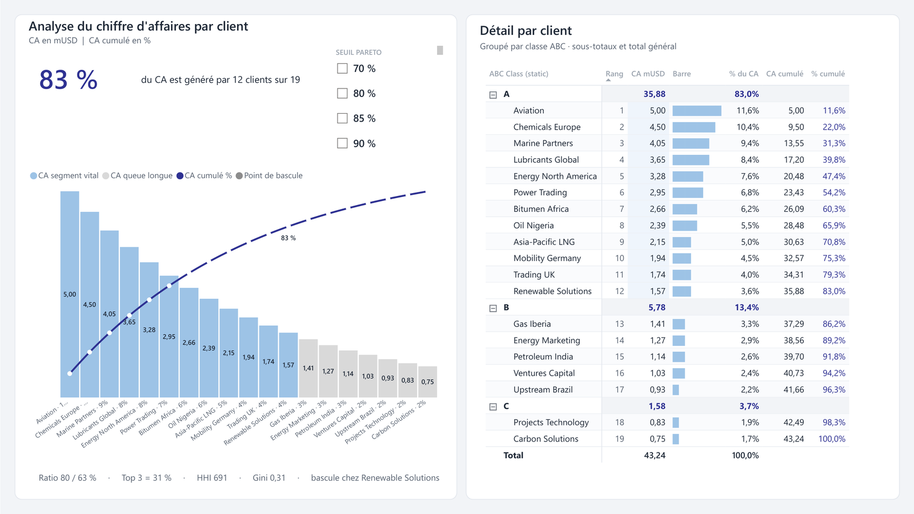

# Analyse Pareto et ABC du chiffre d'affaires

Rapport Power BI d'une page qui repond a une seule question : quelle part du
chiffre d'affaires repose sur quelle part des clients, et ou se situe le point
de bascule.



## Ce que fait le rapport

Un diagramme de Pareto classe les clients par chiffre d'affaires decroissant
et superpose la courbe du cumul. Le seuil de concentration est pilote par un
segment (70, 80, 85 ou 90 %), et tout le rapport se recalcule autour de lui :
le segment vital bascule de couleur, le titre se reecrit, et la matrice de
droite regroupe les clients par classe ABC avec sous totaux.

Sur le jeu de donnees fourni, 83 % du chiffre d'affaires vient de 12 clients
sur 19, et la bascule se produit chez Renewable Solutions.

Le rapport ne se contente pas du ratio 80 / 20. Il affiche aussi les parts du
top 1, du top 3, du top 5 et du top 10, l'indice de Herfindahl Hirschman et le
coefficient de Gini, qui mesurent la concentration du portefeuille autrement
qu'en comptant des clients.

## Les donnees

Le classeur `data/portefeuille-clients.xlsx` contient 19 clients et leur
chiffre d'affaires en millions de dollars.

**Ces chiffres sont fictifs.** Ils servent a demontrer la mecanique du
rapport. Ils ne proviennent d'aucune entreprise reelle et ne doivent etre
cites comme le resultat d'aucune.

## Les pages

| Page | Contenu |
| --- | --- |
| Analyse de Pareto | Le diagramme de Pareto, le segment de seuil, la synthese chiffree et la matrice par classe ABC |
| Info-bulle client | Une page d'info bulle : elle apparait au survol d'un client et donne sa position, sa part et un verdict |

## Le modele

Quatre tables, aucune relation. C'est voulu : les trois tables auxiliaires
sont deconnectees et alimentent des segments que les mesures lisent par
`SELECTEDVALUE`. C'est le motif habituel d'une analyse parametrable.

| Table | Role |
| --- | --- |
| `Sheet1` | Les donnees. Huit colonnes, dont quatre calculees : classe ABC figee, rang fige, ordre de tri de l'axe et libelle d'axe |
| `Pareto Metrics` | Table hote des 70 mesures, sans donnees |
| `Pareto Cutoff` | Table calculee : les quatre seuils de concentration proposes au segment |
| `Top N Buckets` | Table calculee : les paliers de top N |

Les 70 mesures sont rangees en huit dossiers d'affichage, du socle jusqu'a la
couche de presentation :

| Dossier | Ce qu'il contient |
| --- | --- |
| 01 Core | Chiffre d'affaires, total, nombre de clients, parts |
| 02 Pareto | Rang, cumul et cumul en pourcentage |
| 03 Cutoff & Segments | Le seuil selectionne et le decoupage segment vital contre queue longue |
| 04 Concentration | Parts du top 1, 3, 5 et 10, clients jusqu'a 80 %, Herfindahl Hirschman, Gini |
| 05 Formatting | Couleurs conditionnelles, etiquettes et marqueurs de la ligne de seuil |
| 06 Dynamic Titles | Titres et sous titres qui se reecrivent selon la selection |
| 07 Rapport FR | La couche de presentation francaise : les noms affiches dans les visuels |
| 08 Info-bulle | Les trois mesures de la page d'info bulle |

Chaque mesure porte une description, visible dans le volet Donnees de Power
BI. Le detail complet est dans [docs/mesures.md](docs/mesures.md), et le
modele dans [docs/modele-de-donnees.md](docs/modele-de-donnees.md).

## Ouvrir le projet

Il faut Power BI Desktop, version aout 2026 ou plus recente, avec le format
de rapport ameliore PBIR active dans `Fichier > Options > Fonctionnalites en
preversion`.

1. Cloner le depot.
2. Ouvrir `PShell.pbip`.
3. Power BI demande le parametre `DataFolder`. Indiquer le chemin absolu du
   dossier `data` du clone, par exemple
   `C:\depots\analyse-pareto-abc-powerbi\data`.
4. Actualiser.

Le parametre `DataFolder` existe pour que le projet soit portable. Rien
d'autre n'est a modifier apres un clone.

## Arborescence

```
PShell.pbip                   Fichier projet, ouvre le rapport et le modele
PShell.Report/                Definition du rapport au format PBIR
  definition/
    pages/                    Un dossier par page, un dossier par visuel
  StaticResources/
    RegisteredResources/      Le theme du rapport
data/
  portefeuille-clients.xlsx   La source du modele
docs/
  modele-de-donnees.md        Tables, colonnes, parametre de source
  mesures.md                  Les 70 mesures DAX avec leur formule
  images/                     La capture de la page
```

## Licence

MIT. Voir `LICENSE`.
